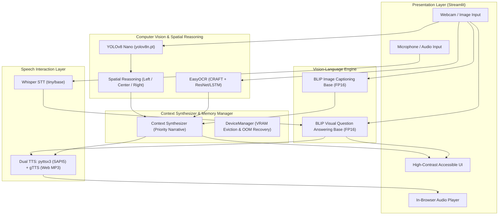

# AI-Powered Visual Assistant for Visually Impaired People Using Computer Vision and NLP

[](https://www.python.org/)
[](https://pytorch.org/)
[](https://developer.nvidia.com/cuda-zone)
[](https://streamlit.io/)
[](LICENSE)

An academic Deep Learning application combining real-time object detection, optical character recognition (OCR), vision-language scene understanding, visual question answering (VQA), and hands-free speech interaction into an accessible cognitive visual assistant.

---

## ⚠️ Important Safety & Ethical Disclaimer

> [!CAUTION]
> **Academic Research Prototype Notice**: This system is designed strictly as an academic research prototype and assistive cognitive aid.
> - It **CANNOT** and **MUST NOT** be used for autonomous obstacle avoidance, traffic navigation, or life-critical mobility.
> - It does **not measure calibrated 3D metric depth**; distance estimations are heuristic based on 2D bounding box area.
> - It does **not replace a white cane, guide dog, or human caregiver**.

---

## 🏗️ System Architecture

The application adopts a decoupled, multi-tier pipeline designed for low-latency inference, modularity, and strict memory safety:



---

## 🧠 Pretrained Models Used

| Capability | Model / Engine | Weights Size | Precision | Memory Behavior |
| :--- | :--- | :--- | :--- | :--- |
| **Object Detection** | **Ultralytics YOLOv8n** | ~6.3 MB | FP32/FP16 | ~150 MB VRAM, unloads when idle |
| **OCR Text Extraction** | **EasyOCR (CRAFT + Latin Recognizer)** | ~95 MB | FP32 | ~350 MB VRAM, unloads when idle |
| **Scene Captioning** | **Salesforce BLIP Base** (`blip-image-captioning-base`) | ~990 MB | FP16 | ~1.0 GB VRAM, unloads when idle |
| **Visual QA (VQA)** | **Salesforce BLIP VQA Base** (`blip-vqa-base`) | ~1.4 GB | FP16 | ~1.3 GB VRAM, unloads when idle |
| **Speech-to-Text (STT)** | **OpenAI Whisper** (`tiny`/`base`) | ~75 MB | FP16 | Pure Python decoding (no external `ffmpeg` binary required) |
| **Text-to-Speech (TTS)** | **pyttsx3 & gTTS** | Lightweight | N/A | Offline Windows SAPI5 + Web in-memory MP3 streaming |

### Known Model Limitations
1. **YOLOv8**: Pretrained on COCO (80 everyday classes). It cannot detect uncommon or domain-specific obstacles without fine-tuning.
2. **EasyOCR**: Accuracy degrades on severely distorted fonts, low contrast, or rapid camera blur.
3. **BLIP Models**: While capable of zero-shot visual reasoning, they are probabilistic and may occasionally hallucinate fine details in response to leading questions.

---

## 💻 Hardware Requirements & Memory Optimization

- **Operating System**: Windows 10 / 11 (64-bit) or Linux.
- **Python**: 3.12 (Supported by PyTorch 2.4+ wheels).
- **RAM**: Minimum 8 GB (16 GB recommended).
- **GPU (Optional)**: NVIDIA GeForce RTX 2050 (4 GB VRAM) or higher with CUDA 12.x support.
- **Dynamic VRAM Safety**:
  To protect against CUDA Out-Of-Memory (OOM) crashes on 4GB VRAM GPUs, models are:
  - Loaded lazily on demand.
  - Cast to `torch.float16` when running on CUDA.
  - Unloaded immediately after inference using `torch.cuda.empty_cache()` and `gc.collect()`.
  - Wrapped in automatic CPU fallbacks if VRAM is constrained.

---

## 🚀 Setup & Installation Guide

### 1. Clone or Open the Repository
```powershell
cd "c:\Users\jagan\OneDrive\Documents\Deeplearning project"
```

### 2. Create and Activate Virtual Environment
```powershell
python -m venv .venv
.\.venv\Scripts\Activate.ps1
```

### 3. Install PyTorch with CUDA Acceleration
```powershell
pip install torch torchvision --index-url https://download.pytorch.org/whl/cu124
```

### 4. Install Project Dependencies
```powershell
pip install -r requirements.txt
```

---

## 🧪 Running Automated Tests

Run the automated test suite covering Vision, OCR, NLP, and Speech:

```powershell
.\.venv\Scripts\python.exe -m pytest tests/ -v
```
Expected output: **12 passed in ~30s**.

---

## 🖥️ Running the Application

### Launch the Streamlit Web Application
```powershell
.\.venv\Scripts\python.exe -m streamlit run app.py
```
Open your browser at `http://localhost:8501`.

### Interactive Features:
1. **Full Scene Analysis**:
   - Capture a photo using your webcam or upload an image.
   - Click **"⚡ Describe My Surroundings"**.
   - Generates high-contrast visual annotations, safety cards, and automatic spoken audio narration.
2. **Voice & Visual Q&A**:
   - Record your question via your microphone (e.g. *"What is the color of the bus?"* or *"Is the floor wet?"*).
   - Whisper transcribes your query, BLIP VQA inspects visual features, and the answer is spoken aloud.
3. **Dedicated Object & Obstacle Detector**:
   - Spatial positioning (*on your left*, *directly in front*, *on your right*) and proximity warnings.
4. **Dedicated Sign & Text Reader**:
   - Extracts printed notices and labels sorted in natural reading order (top-to-bottom, left-to-right).

---

## 🔬 Standalone Demonstration Scripts

Individual modules can be tested directly from the command line:

```powershell
# 1. Hardware & Environment Diagnostics
python tests/verify_env.py

# 2. YOLO Object Detection & Spatial Reasoning Demo
python scripts/run_detector_demo.py sample_images/bus.jpg

# 3. OCR Text Extraction Demo
python scripts/run_ocr_demo.py

# 4. Multimodal Scene Captioning & Visual Q&A Demo
python scripts/run_vlm_demo.py sample_images/bus.jpg

# 5. Speech Synthesis & Recognition Demo
python scripts/run_speech_demo.py
```

---

## 📁 Repository Structure

```text
deeplearning-visual-assistant/
├── app.py                         # Accessible Streamlit application
├── requirements.txt               # Pinned, verified dependencies
├── .gitignore                     # Protects models, venv, and caches
├── README.md                      # Comprehensive academic documentation
├── sample_images/
│   └── bus.jpg                    # Sample evaluation image
├── models_cache/                  # Local directory for model weights & caches
│   ├── yolo/                      # YOLOv8n checkpoints
│   ├── easyocr/                   # CRAFT & English recognizer weights
│   ├── huggingface/               # BLIP models
│   └── whisper/                   # Whisper speech checkpoints
├── src/
│   ├── vision/
│   │   ├── object_detector.py     # YOLOv8 + Spatial positioning heuristic
│   │   └── utils.py               # Image processing & synthetic generators
│   ├── ocr/
│   │   ├── ocr_reader.py          # EasyOCR text reader + reading order
│   │   └── download_models.py     # Resilient chunked model downloader
│   ├── nlp/
│   │   ├── scene_captioner.py     # BLIP scene understanding
│   │   └── vqa_engine.py          # BLIP Visual Question Answering
│   ├── speech/
│   │   ├── speech_recognizer.py   # Whisper STT (pure Python soundfile)
│   │   └── text_to_speech.py      # Dual pyttsx3 & gTTS synthesis
│   └── utils/
│       ├── device_manager.py      # CUDA OOM protection & VRAM monitor
│       └── context_synthesizer.py # Multimodal narrative assembler
├── scripts/
│   ├── run_detector_demo.py       # Standalone vision demo
│   ├── run_ocr_demo.py            # Standalone OCR demo
│   ├── run_vlm_demo.py            # Standalone VLM demo
│   └── run_speech_demo.py         # Standalone speech demo
└── tests/
    ├── verify_env.py              # Preflight GPU/RAM verification
    ├── test_detector.py           # Unit tests for object detection
    ├── test_ocr.py                # Unit tests for OCR
    ├── test_nlp.py                # Unit tests for VLM & synthesizer
    └── test_speech.py             # Unit tests for STT & TTS
```

---

## 📜 License
This academic project is licensed under the MIT License - see the LICENSE file for details.
