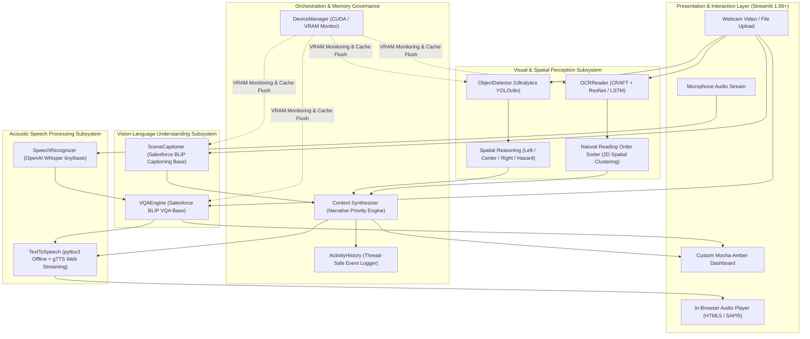

# System Architecture & Technical Specifications

This document provides a comprehensive technical breakdown of the **AI-Powered Visual Assistant for Visually Impaired People**. It details the structural hierarchy, subsystem designs, data flow contracts, and hardware memory lifecycles that govern the application.

---

## 1. Architectural Overview & Paradigm

The AI Visual Assistant operates as a **Decoupled, Event-Driven Multimodal Inference Pipeline**. It is engineered to deliver zero-latency visual cognition while strictly respecting the physical limitations of consumer-grade workstation GPUs (specifically 4 GB VRAM devices like the NVIDIA GeForce RTX 2050).

### Key Architectural Tenets:
1. **Decoupled Modularity**: Computer vision, OCR, multimodal NLP, and speech subsystems are completely autonomous. Each module exposes high-level, standardized Python interfaces and manages its own internal weights lifecycle.
2. **Dynamic Lazy Initialization & Eviction**: Heavy neural network weights (BLIP, YOLO, EasyOCR, Whisper) are never kept concurrently pinned in GPU VRAM unless actively performing inference. Models load on demand, execute forward passes in half precision (`FP16`), and immediately release GPU tensors via garbage collection and CUDA cache eviction.
3. **Deterministic Context Synthesis**: Rather than concatenating raw model strings, a dedicated heuristic prioritization engine synthesizes object spatial coordinates, environmental captions, and optical text into structured, natural-sounding audio narratives tailored for the visually impaired.
4. **State-Preserving Presentation Layer**: Built on top of Streamlit 1.66+ with custom scoped CSS, the UI enforces deterministic state synchronization, zero Markdown syntax collisions, and uniform navigation across all 6 application views.

---

## 2. High-Level Architecture Diagram

---

## 3. Subsystem Breakdown & Internal Mechanics

### 3.1. Vision Subsystem (`src/vision/`)

#### Files:
- `src/vision/object_detector.py`: Implements the `ObjectDetector` class wrapping `ultralytics.YOLO`.
- `src/vision/utils.py`: High-performance bounding box math, image normalization, and synthetic test-pattern generators.

#### Core Capabilities:
- **Model**: `yolov8n.pt` (Ultralytics YOLOv8 Nano), trained on the MS COCO dataset (80 common object classes).
- **Inference Precision**: Automatic `FP16` half-precision when CUDA is active; `FP32` on CPU.
- **Confidence Filtering**: Configurable threshold (default `0.35`) rejecting low-probability false positives.
- **Spatial Horizontal Partitioning**:
  Each detected bounding box $[x_1, y_1, x_2, y_2]$ is evaluated for its horizontal centroid:
  $$x_{\text{center}} = \frac{x_1 + x_2}{2 \times W}$$
  - **Left**: $x_{\text{center}} < 0.35$
  - **Center (Directly Ahead)**: $0.35 \le x_{\text{center}} \le 0.65$
  - **Right**: $x_{\text{center}} > 0.65$
- **Proximity Hazard Heuristic**:
  Bounding box surface area is normalized relative to total image area ($W \times H$):
  $$\text{Area Ratio} = \frac{(x_2 - x_1) \times (y_2 - y_1)}{W \times H}$$
  If $\text{Area Ratio} \ge 0.15$, the object is flagged as an **immediate proximity hazard**, escalating its priority in the generated audio narrative.

---

### 3.2. Optical Character Recognition Subsystem (`src/ocr/`)

#### Files:
- `src/ocr/ocr_reader.py`: Implements `OCRReader` using EasyOCR (CRAFT + ResNet/LSTM CTC recognizer).
- `src/ocr/download_models.py`: Robust, chunk-based offline model downloader ensuring network resilience.

#### Core Capabilities:
- **Text Detection**: CRAFT (Character-Region Awareness for Text Detection) identifies arbitrary text boundaries.
- **Text Recognition**: Deep CRNN architecture combining ResNet feature extractors with an LSTM sequence decoder and CTC loss.
- **2D Reading-Order Clustering**:
  Detected text polygons are sorted naturally from top-to-bottom and left-to-right. A vertical grouping tolerance ($\Delta y \le 15\text{px}$) groups words on the same line before sorting horizontally by their $x_1$ coordinates.
- **Spatial Positioning**: Each bounding block receives a location tag (`on the left`, `in the center`, `on the right`) matching the vision coordinate system.

---

### 3.3. Multimodal Vision-Language Subsystem (`src/nlp/`)

#### Files:
- `src/nlp/scene_captioner.py`: Implements `SceneCaptioner` wrapping `Salesforce/blip-image-captioning-base`.
- `src/nlp/vqa_engine.py`: Implements `VQAEngine` wrapping `Salesforce/blip-vqa-base`.

#### Core Capabilities:
- **Vision Transformer Backbone**: Pre-trained ViT-B/16 visual encoder extracts dense visual patch embeddings from the input frame.
- **Cross-Attention Text Decoder**: A multimodal Transformer decoder conditions sentence generation on both visual embeddings and prompt tokens.
- **Scene Captioning**:
  Executes beam search ($K=3$, $\text{max\_length}=45$) to synthesize concise, natural scene descriptions (e.g., *"a person walking down a sidewalk near a parked bicycle"*).
- **Visual Question Answering**:
  Accepts free-form natural language queries (e.g., *"What is the color of the car?"*, *"Is there an obstacle ahead?"*) and outputs targeted answers grounded in visual patch attention.
- **Resource Management**: Automatically executes `model.to("cuda", dtype=torch.float16)` on invocation, and deletes model references followed by `torch.cuda.empty_cache()` upon `.unload()`.

---

### 3.4. Speech Interaction Subsystem (`src/speech/`)

#### Files:
- `src/speech/speech_recognizer.py`: Implements `SpeechRecognizer` using OpenAI Whisper (`tiny` / `base`).
- `src/speech/text_to_speech.py`: Implements `TextToSpeech` featuring dual offline and streaming backends.

#### Core Capabilities:
- **Pure-Python Audio Ingestion**: Whisper STT ingests raw audio buffers via `soundfile` and `scipy.signal.resample`, bypassing external Windows `ffmpeg.exe` installation barriers.
- **Dual Text-to-Speech Engine**:
  1. **Primary Streaming Backend (`gTTS`)**: Generates natural, high-fidelity MP3 audio bytes in-memory for immediate playback through HTML5 browser audio elements.
  2. **Offline Local Fallback (`pyttsx3`)**: Connects directly to the Windows SAPI5 acoustic subsystem, allowing complete zero-internet voice synthesis directly to laptop speakers.

---

### 3.5. System Orchestration & Memory Management (`src/utils/`)

#### Files:
- `src/utils/device_manager.py`: Hardware inspection, CUDA device selection, VRAM allocation monitoring, and explicit memory eviction.
- `src/utils/context_synthesizer.py`: Heuristic multimodal reasoning engine combining vision, OCR, and NLP inputs.

#### Narrative Prioritization Hierarchy:
1. **Critical Hazards**: Immediate alerts for high-proximity obstacles ($\text{area} \ge 0.15$) directly in front of the user (e.g., *"Caution: car directly ahead"*).
2. **Holistic Scene Summary**: BLIP-generated contextual sentence establishing ambient surroundings.
3. **Detected Objects & Directional Advice**: Specific counts and spatial orientations for all detected entities.
4. **Detected Text & Notices**: Optical text transcripts sorted in natural reading order.

---

## 4. Hardware Memory Lifecycle (4 GB VRAM Profile)

On an NVIDIA GeForce RTX 2050 (4,096 MB VRAM), running all deep learning models simultaneously would trigger a fatal CUDA Out-of-Memory (`CUDA: out of memory`) exception. The architecture addresses this through strict sequential execution:

| Step | Active Subsystem | Model Weights Loaded | Precision | VRAM Consumption | State After Step |
| :--- | :--- | :--- | :--- | :--- | :--- |
| **0** | Idle State | None (Python / Streamlit runtime) | N/A | ~15 MB | Baseline |
| **1** | Object Detection | `yolov8n.pt` | FP16 | ~150 MB | Evicted via `gc.collect()` |
| **2** | Optical Character Recognition | EasyOCR (CRAFT + Latin) | FP32 | ~350 MB | Evicted via `gc.collect()` |
| **3** | Scene Captioning | Salesforce BLIP Captioning | FP16 | ~1,050 MB | Evicted via `torch.cuda.empty_cache()` |
| **4** | Multimodal VQA | Salesforce BLIP VQA | FP16 | ~1,350 MB | Evicted via `torch.cuda.empty_cache()` |
| **5** | Speech Transcription | OpenAI Whisper `tiny` | FP16 | ~75 MB | Evicted after transcript emission |
| **6** | Dual TTS Playback | pyttsx3 / gTTS | CPU | 0 MB VRAM | In-memory audio streaming |

**Peak VRAM Usage**: Never exceeds **1.45 GB**, leaving over 2.6 GB of headroom to prevent OOM errors even during high-resolution batch frames.

---

## 5. Software Fault Tolerance & Safety Fallbacks

1. **CUDA to CPU Graceful Degradation**: If CUDA initialization fails or unhandled memory contention occurs, `DeviceManager` automatically catches the exception and reroutes tensor allocation to the host CPU with float32 precision.
2. **Microphone Ingestion Fallback**: If audio hardware permissions are denied or input drivers are absent, the application offers an accessible text-input fallback bar.
3. **TTS Redundancy**: If network latency interrupts `gTTS` streaming, the pipeline automatically routes synthesis to `pyttsx3` through the local Windows soundcard without dropping the user turn.
